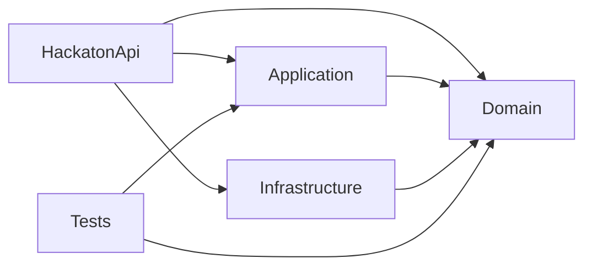

# Guia do backend do hackathon — .NET, C# e DDD

Origem: `C:\Projeto\portifolio-back\portfolio-back`.
Destino: `C:\Projeto\Hackaton-backend`. Análise local: 08/10/2026.

## 1. Objetivo e fontes de verdade

Este documento orienta a criação do backend do hackathon seguindo a arquitetura e as bases do portfólio. Nesta etapa há apenas documentação: não foram criados projetos C#, endpoints, banco ou regras de negócio.

Prioridade: instruções do usuário, implementação local e regras operacionais do `CLAUDE.md`. O `DDD_STANDARDS.md` é referência histórica/aspiracional da arquitetura FreteFy, não uma descrição integral do backend atual. Havendo dúvida, leia os arquivos da origem citados neste guia.

**Existente** significa confirmado no código. **Regra de reutilização** indica o padrão a manter. **Melhoria proposta** identifica mudança que não está implementada na origem. Não confundir infraestrutura reutilizável com domínio do novo produto.

Não copiar entidades de portfólio, conteúdo de seed, contas, senhas, connection strings, chaves JWT/IA ou configurações pessoais para o hackathon. Segredos não são reproduzidos neste guia.

## 2. Solução e dependências entre camadas

Todos os cinco projetos analisados usam `net8.0`, nullable e implicit usings habilitados. Nomes propostos para a nova solução:

```text
Hackaton-backend/
  Hackaton.Domain/
    Entities/                 # Entity e EntityAudited; entidades futuras
    Enums/
    Interface/
      Markers/                # IMustAudited
    Services/                 # DomainService<T> e serviços específicos
    DomainContainer.cs
  Hackaton.Application/
    DTOs/                     # Organizados por recurso
    Interface/
    Services/                 # AppService<TEntity,TDto>
    Validators/
    Mappings/                 # Mapster IRegister
    Exceptions/
    DependencyInjection.cs
  Hackaton.Infrastructure/
    Data/
      Map/                    # IEntityTypeConfiguration<T>
      Migrations/             # Migrations próprias, quando houver modelo
      AppDbContext.cs
      CacheKeys.cs
    Repositories/             # GenericRepository<T>
    UnitOfWork/
    Auth/                     # Se autenticação for necessária
    DependencyInjection.cs
  HackatonApi/
    Controllers/              # BaseController<TEntity,TDto>
    Middlewares/
    Swagger/
    Auth/                     # Adaptador IUserResolver, quando aplicável
    Program.cs
    appsettings.json          # Apenas configuração sem segredos
  Hackaton.Tests/
    Domain/
    Application/
  Hackaton.sln ou Hackaton.slnx
```

Esta árvore é uma proposta, não código já gerado.



Domain não referencia Application, Infrastructure, ASP.NET ou EF Core. A única dependência externa atual do Domain é `Microsoft.Extensions.DependencyInjection.Abstractions`, para `AddDomain()`. Application referencia apenas Domain; implementações técnicas ficam em Infrastructure. A API realiza a composição e resolve interfaces por DI.

## 3. Fluxo obrigatório e regras do agente

```text
HTTP -> Controller -> AppService -> DomainService -> Repository -> EF Core
                            |
                            +-> IUnitOfWork -> persistência/auditoria/cache
```

1. Controllers CRUD herdam `BaseController<TEntity,TDto>` e chamam AppServices.
2. AppService valida DTO, mapeia, coordena o caso de uso e confirma a unidade de trabalho.
3. DomainService concentra regras de negócio e depende de interfaces de repositório.
4. Repository consulta e altera o ChangeTracker, sem salvar.
5. UoW é a fronteira de persistência dos casos de uso, auditoria e invalidação de cache.
6. Preservar métodos `virtual` nas bases, permitindo extensão por `override` sem duplicar CRUD.
7. Não introduzir MediatR, CQRS/handlers, Result<T>, AutoMapper, MongoDB, mensageria, multi-tenancy, domain events ou soft delete como se já existissem. MediatR/CQRS e Result<T> são explicitamente excluídos pelas regras operacionais atuais.
8. Não chamar Repository/DbContext no Controller; não chamar Infrastructure ou DbContext na Application; não fazer AppService chamar outro AppService nem DomainService chamar AppService.
9. Propagar CancellationToken por leituras, validação e persistência assíncrona.
10. Não inventar entidades ou invariantes enquanto as regras do hackathon não forem fornecidas.

**Nuance confirmada:** o seeder original chama `SaveChangesAsync` diretamente no bootstrap. A regra de persistência pela UoW vale aos casos de uso; existe essa exceção técnica no código. Não copiar o seed pessoal nem tratar a exceção como permissão para salvar em serviços/repositórios.

## 4. Entidades abstratas — preservar a modelagem

As definições completas originais estão no apêndice deste documento.

### Entity

`public abstract class Entity` possui `public Guid Id { get; set; } = Guid.NewGuid();`.

- Identidade Guid, setter público e valor inicial gerado na entidade.
- Não possui igualdade customizada, domain events, tenant, soft delete ou restrição a AggregateRoot.
- AppService gera novamente o Id na criação, de maneira incondicional. O body não controla a identidade.
- No update o Id da URL é restaurado após o mapping.
- Maps EF usam `ValueGeneratedNever()` para Id; o identificador vem da aplicação.

**Regra de reutilização:** manter esse contrato; não trocar setters por privados, Id por int, base por record ou introduzir uma base AggregateRoot silenciosamente.

### EntityAudited e IMustAudited

`public abstract class EntityAudited : Entity, IMustAudited` acrescenta:

| Campo | Tipo e acesso |
|---|---|
| CreationUserId | Guid, get/set |
| CreationTime | DateTime, get/set |
| ModificationUserId | Guid?, get/set |
| ModificationTime | DateTime?, get/set |

`IMustAudited` declara exatamente os mesmos quatro campos. É o contrato usado pelo ChangeTracker, não apenas um marcador vazio.

A origem usa `User : EntityAudited`; Mensagem, Habilidade, ProjetoCarousel, Trabalho, LinkSocial e Contato herdam `Entity`. Auditoria não é obrigatória para toda entidade.

**Regra de reutilização:** escolher `Entity` ou `EntityAudited` conforme a necessidade. Não criar manualmente campos duplicados nas entidades concretas. Auditoria pertence ao servidor, não à entrada do usuário.

### Bases genéricas não são todas abstratas

| Base | Declaração real | Extensão |
|---|---|---|
| Entity | abstract class | Identidade |
| EntityAudited | abstract class | Identidade e auditoria |
| DomainService<T> | class concreta | Métodos virtual |
| AppService<TEntity,TDto> | class concreta | Métodos virtual e ValidarAsync protected virtual |
| GenericRepository<T> | class concreta | Métodos virtual |
| BaseController<TEntity,TDto> | abstract class | Ações virtual |
| UnitOfWork | sealed class | Implementa IUnitOfWork, IDisposable e IAsyncDisposable |

Todas as restrições genéricas existentes usam `where T : Entity` ou `where TEntity : Entity`, não `EntityAudited`. Preservar classes concretas e abstratas do jeito existente, sem transformar todas em abstract.

## 5. Contratos e responsabilidades das bases

### IRepository<T> e IDomainService<T>

Ambas as interfaces expõem `GetAllAsync(CancellationToken = default)`, `GetByIdAsync(Guid, CancellationToken = default)`, `void Add(T)`, `void Update(T)` e `void Remove(T)`. Leituras retornam `Task<IEnumerable<T>>` e `Task<T?>`.

DomainService possui `_repository` protected readonly e delega os cinco métodos. Interfaces específicas herdam o contrato fechado; serviços específicos herdam a classe genérica e recebem o repositório específico. Add/Update/Remove são síncronos porque apenas alteram o estado rastreado.

### IAppService<TEntity,TDto> e AppService<TEntity,TDto>

Contrato: `GetAllAsync`, `GetAsync(Guid)`, `CreateAsync(TDto)`, `UpdateAsync(Guid,TDto)` e `DeleteAsync(Guid)`, todos com CancellationToken opcional.

A base recebe `IDomainService<TEntity>`, `IUnitOfWork`, `MapsterMapper.IMapper` e `IEnumerable<IValidator<TDto>>`. Os campos são protected readonly.

- GetAll mapeia a coleção; GetAsync retorna default se não encontrou entidade.
- Create verifica DTO nulo, valida, mapeia, substitui Id por novo Guid, chama Begin, Add e Confirm, e retorna DTO.
- Update valida antes da busca, lança EntityNotFoundException quando necessário, mapeia sobre a entidade existente, restaura Id da URL, chama Begin, Update e Confirm.
- Delete busca, lança EntityNotFoundException se ausente, chama Begin, Remove e Confirm.
- ValidarAsync executa validators com Task.WhenAll, agrega ErrorMessage e lança EntityValidationException. Sem validators registrados, não valida nada.

**Regra de reutilização:** registrar validators reais para os DTOs que exigirem regras. Não atribuir garantias ao FluentValidation só por ter instalado o pacote. Regras de domínio futuras ficam em entidades/DomainServices conforme a modelagem; os modelos atuais são predominantemente CRUD com propriedades públicas.

### GenericRepository<T>, cache e rastreamento

Construtor real: `(AppDbContext context, IMemoryCache cache)`; mantém `_context`, `_dbSet` e `_cache` protected readonly.

GetAll usa AsNoTracking, ToListAsync e cache em memória com expiração deslizante de 30 minutos. A chave é `Repository:{NomeDoTipo}:all`. GetById usa FindAsync e pode retornar entidade rastreada. Add/Update/Remove apenas atuam no DbSet.

**Atenção à fidelidade:** o checklist antigo do CLAUDE.md mostra um construtor de repository sem cache. O código real exige os dois parâmetros; seguir o código. Não registrar IMemoryCache como recurso opcional enquanto reutilizar essa base.

Não há paginação, cache distribuído ou ordenação genérica garantida. Qualquer introdução deve ser documentada como mudança nova.

## 6. Unidade de trabalho e auditoria

IUnitOfWork expõe `void Begin()`, `Task<int> Confirm(...)`, `Task BeginTransaction(...)`, `Task ConfirmTransaction(...)` e `Task RejectTransaction(...)`.

**Comportamento real:** Begin tem corpo vazio. Não abre transação SQL. Confirm coleta os tipos alterados, aplica auditoria, executa SaveChangesAsync e só depois invalida as chaves de listas.

As transações explícitas usam Stack<IDbContextTransaction>. BeginTransaction chama Database.BeginTransactionAsync. ConfirmTransaction salva, faz commit, invalida cache e descarta a transação no finally. RejectTransaction faz rollback e descarte; sem transação ativa retorna. ConfirmTransaction sem transação ativa lança InvalidOperationException. Dispose/DisposeAsync descartam o que restar na pilha.

**Limites:** a pilha não prova suporte a transações aninhadas/savepoints. Rollback não restaura automaticamente o estado dos objetos no ChangeTracker. Confirm não controla por si só o commit de uma transação explícita. Não atribuir comportamentos adicionais sem implementar e testar.

Auditoria usa DateTime.UtcNow e IUserResolver.GetCurrentUserId():

- Added: define criação e limpa os campos de modificação.
- Modified: define modificação e marca os dois campos de criação como IsModified = false.
- Deleted: não acrescenta campo de exclusão.

IUserResolver está no Domain; HttpContextUserResolver está na API. Lê sub ou NameIdentifier do usuário autenticado; usuário ausente/não autenticado/Id inválido retorna Guid.Empty. Não é o repositório que lê HttpContext.

**Melhoria proposta para entidades auditadas:** ignorar campos de auditoria na direção DTO -> Entity e mantê-los apenas como saída se expostos. Os maps atuais não demonstram um mapping CRUD de User; não presumir que essa defesa já existe para todas as entidades.

## 7. DTOs, mapping, validação e EF

- DTOs no Application: `sealed record`, estilo de propriedades, não positional, com get/init e strings iniciadas em string.Empty.
- Um DTO por entidade CRUD no padrão atual, sem separar CreateDto e UpdateDto automaticamente.
- Id usa `[ReadOnly(true)]` de System.ComponentModel.
- Mapster: classe `IRegister`, configura Entity -> Dto e Dto -> Entity com `.Ignore(dest => dest.Id)`.
- ReadOnly e os filtros Swagger documentam o contrato; não impedem sozinhos a desserialização. A proteção real do Id está no mapping e AppService.
- Validators herdam `AbstractValidator<TDto>`; são descobertos por assembly.
- Maps EF herdam `IEntityTypeConfiguration<TEntity>` e definem tabela, chave, propriedades, limites e índices. Aplicados por ApplyConfigurationsFromAssembly no DbContext.
- Tabelas seguem nomes minúsculos plurais/snake_case conforme necessário. Definir nomes explicitamente, sem inventar convenção global de colunas que não está no código.
- Migration própria por evolução do modelo; não copiar migrations do portfólio.

## 8. API, erros e autenticação

BaseController usa `[ApiController]` e `[Route("api/[controller]")]`.

| Ação | Acesso atual | Resultado |
|---|---|---|
| GET coleção | AllowAnonymous | 200 e coleção de DTOs |
| GET {id:guid} | AllowAnonymous | 200 ou 404 |
| POST | Authorize Roles=Admin | 200 e DTO criado |
| PUT {id:guid} | Authorize Roles=Admin | 200 e DTO atualizado |
| DELETE {id:guid} | Authorize Roles=Admin | 204 |

Preservar essa base como referência; o modelo de autorização do produto deve ser confirmado quando as regras chegarem. Não remover proteção de escrita silenciosamente. POST não retorna 201 na origem.

Para endpoints que não são CRUD, como login/chat, a origem usa ControllerBase e interfaces próprias de AppService. Não forçar herança genérica em qualquer operação.

GlobalExceptionHandler implementa IExceptionHandler e traduz EntityValidationException em 400, EntityNotFoundException em 404, BadCredentialsException em 401 e outras em 500 com ProblemDetails. É registrado por AddProblemDetails/AddExceptionHandler e UseExceptionHandler.

**Diferença importante:** o handler original inclui mensagens da exceção e internas no Detail de 500 inclusive fora de Development; apenas stack trace e metadados ficam restritos ao desenvolvimento. **Melhoria proposta:** responder mensagem genérica em produção e manter detalhes no log. Não afirmar que o código atual já oculta tudo.

Swagger usa ApplyReadOnlyAttributeSchemaFilter e HideReadOnlyInRequestBodyFilter para gerar schema de entrada sem campos readOnly, mantendo os campos na resposta. Registrar ambos para preservar o comportamento.

JWT/BCrypt existentes: AuthAppService valida login, usa IUserService, IPasswordHasher e IJwtTokenGenerator; não usa UoW porque é leitura. JWT valida issuer, audience, lifetime e signing key, ClockSkew zero. Roles atuais: Admin e Visitante. Não há refresh token, revogação ou logout demonstrados. Credenciais e seed pessoal não devem ser reutilizados.

CORS lê AllowedOrigins e usa WithOrigins, AllowAnyHeader e AllowAnyMethod. Pipeline: exception handler -> HTTPS -> CORS -> authentication -> authorization -> controllers. Adequar origens ao frontend do hackathon; não copiar domínio de produção pessoal.

## 9. Injeção de dependências

| Camada | Método | Registros atuais |
|---|---|---|
| Domain | AddDomain() | IDomainService<>/DomainService<> e interfaces específicas scoped |
| Application | AddApplication() | AppServices scoped, scan Mapster, config singleton, IMapper/ServiceMapper scoped, validators por assembly |
| Infrastructure | AddInfrastructure(configuration) | DbContext MySQL, MemoryCache, repositories scoped, UoW scoped, adaptadores de integrações |
| API | Program.cs | Composição das três camadas, IUserResolver scoped, HTTP, JWT, CORS, Swagger e erros |

MySQL usa Pomelo e ServerVersion.AutoDetect(connectionString), que requer acesso ao servidor para detectar a versão. Não prometer que essa configuração sobe sem banco.

Interfaces de autenticação/IA ficam no Domain; implementações técnicas ficam em Infrastructure. Os módulos de IA e traduções são específicos do portfólio e opcionais no hackathon.

## 10. Bibliotecas exatas da referência

As versões do inventário no apêndice são extraídas dos csproj locais, não consultadas no NuGet. Não representam atualização ou garantia de suporte atual. Preservar compatibilidade entre .NET 8, EF 8 e Pomelo 8 ao reproduzir a base; migrações de versão são decisões separadas.

| Grupo | Papel |
|---|---|
| ASP.NET Core/JwtBearer | API e autenticação Bearer |
| EF Core, Design e Tools | ORM e migrations |
| Pomelo.EntityFrameworkCore.MySql | Provedor MySQL |
| FluentValidation e DI extensions | Validação de DTO e registro por assembly |
| Mapster e Mapster.DependencyInjection | Mapping DTO/entidade |
| Microsoft.Extensions.* | DI, configuração, options e cache |
| BCrypt.Net-Next | Hash de senhas, quando necessário |
| Microsoft.IdentityModel.Tokens/System.IdentityModel.Tokens.Jwt | Emissão e validação de tokens |
| Swashbuckle.AspNetCore | Swagger/OpenAPI e filtros |
| Anthropic | Integração de IA opcional e específica da origem |
| Microsoft.VisualStudio.Azure.Containers.Tools.Targets | Ferramentas de containers do Visual Studio |
| xUnit, runner, Test.Sdk, Moq, FluentAssertions e coverlet.collector | Testes, mocks, asserções e coleta de cobertura |

## 11. Skills e convenções

Não foi encontrado SKILL.md ou AGENTS.md na árvore do backend analisado. CLAUDE.md é um manual do repositório, não prova de uma skill instalada. Este guia também não instala skill ou ferramenta.

Competências necessárias: C#/.NET e ASP.NET Core; DDD por camadas e herança genérica; EF Core/MySQL; UoW e transações; Mapster; FluentValidation; DI; JWT/BCrypt quando aplicáveis; testes xUnit/Moq/FluentAssertions; Swagger e configuração.

Seguir português para conceitos de negócio e inglês para infraestrutura; interfaces prefixadas I; sufixos Dto, Map, Validator, Service, AppService e Repository. Preservar a pasta `Interface` singular e namespaces correspondentes à camada. Skills efetivamente disponíveis no ambiente só devem ser usadas quando pertinentes e após ler suas instruções.

## 12. Criar uma entidade futuramente

1. Definir seu papel, propriedades e necessidade de auditoria com as regras do produto.
2. Criar entidade herdando Entity ou EntityAudited.
3. Criar IRecursoRepository : IRepository<Recurso> e IRecursoService : IDomainService<Recurso>.
4. Criar RecursoService : DomainService<Recurso>, IRecursoService; registrar AddDomain.
5. Se houver CRUD público, criar DTO, validator, mapping e interface IRecursosAppService : IAppService<Recurso,RecursoDto>.
6. Criar RecursosAppService herdando AppService e registrar AddApplication.
7. Criar Map EF, DbSet e RecursoRepository : GenericRepository<Recurso>, IRecursoRepository com construtor (AppDbContext, IMemoryCache).
8. Registrar repository em AddInfrastructure.
9. Criar RecursosController : BaseController<Recurso,RecursoDto> se houver CRUD HTTP.
10. Criar/revisar migration própria e aplicá-la ao banco indicado.
11. Verificar validação, Id do servidor/URL, erros, autorização e persistência.

Entidades internas não precisam automaticamente de DTO ou controller público. Services e repositories específicos podem ter apenas construtor enquanto não houver lógica adicional.

## 13. Etapas pequenas para o esqueleto

1. Criar solução e projetos, referências e configuração sem segredos.
2. Adicionar Entity, EntityAudited, IMustAudited e interfaces genéricas.
3. Adicionar as bases de serviços, repositório e UoW conforme o apêndice.
4. Configurar EF, DI e resolver de auditoria conforme banco/autenticação escolhidos.
5. Adicionar BaseController, erros e filtros Swagger.
6. Validar build e testes pertinentes antes de inserir regras do produto.

Banco, login, seed, migrations de entidades, IA e integração ao frontend dependem das decisões do produto. Se desejar um esqueleto que suba sem banco, isso requer configuração deliberada distinta do AddInfrastructure/seed original; registrar a escolha antes de implementá-la.

## 14. Comandos e limites de verificação

Exemplos para a solução futura, ainda não executáveis nesta pasta documental:

```powershell
dotnet restore Hackaton.sln
dotnet build Hackaton.sln --no-restore
dotnet test Hackaton.Tests/Hackaton.Tests.csproj
dotnet run --project HackatonApi/HackatonApi.csproj
dotnet ef migrations add Nome -p Hackaton.Infrastructure -s HackatonApi
dotnet ef database update -p Hackaton.Infrastructure -s HackatonApi
```

Usar o nome/formato real da solução criada. A origem usa PortfolioApi.slnx e não inclui Portfolio.Tests nele; os testes precisam ser invocados pelo csproj ou incluídos deliberadamente na nova solução. O CI original instala SDK 8 e 9 e roda restore/build/test; não assumir que testa o projeto excluído da solução. O Dockerfile raiz compila/publica pelo csproj da API com SDK/runtime 8, não pela solução.

Na máquina foi observado SDK 10.0.401. Target net8.0 não equivale a SDK 8 instalado nem runtime 8 presente; verificar ferramentas e runtime ao montar o projeto. Não executar comandos pesados em paralelo sem necessidade.

O seeder original verifica migrations pendentes e impede o boot se o schema estiver atrasado; não faz auto-migrate. Aplicação de migrations é passo separado. Configurar banco e JWT por variáveis/User Secrets quando necessário, sem valores pessoais versionados.

Testes existentes cobrem Mensagem, MensagemService, MensagensAppService e MensagemDtoValidator. Os testes de AppService verificam Id gerado, Id da URL, validação, entidade ausente, mapping e confirmação UoW. Não há evidência de testes de persistência, auditoria, controllers e autenticação nessa árvore.

Esta entrega é baseada em leitura de código e configuração; não executou restore, build, testes, banco, Docker ou chamadas à API original. Não apresenta a solução como integralmente validada.

## 15. Prompt reutilizável

```text
Crie o backend em C:\Projeto\Hackaton-backend seguindo este guia.
Use .NET/C# e a arquitetura por camadas da referência.
Preserve Entity, EntityAudited, IMustAudited e as bases genéricas,
com métodos virtuais, contratos e responsabilidades documentados.
Consulte C:\Projeto\portifolio-back\portfolio-back se houver dúvida.
Não introduza MediatR/CQRS, Result<T> ou AutoMapper.
Não copie segredos, seed, entidades e migrations pessoais do portfólio.
Trabalhe em etapas pequenas e registre mudanças deliberadas em relação à origem.
Ainda não há regras de negócio: inicialmente prepare apenas a infraestrutura
autorizada, sem inventar funcionalidades. Atualize o README e valide os checks
pertinentes ao código que for criado. Não publique sem autorização.
```

## 16. Apêndices de referência

Os apêndices a seguir reproduzem os arquivos locais das bases técnicas e inventariam as dependências. São referência documental, não projetos compiláveis nesta pasta. Ao reutilizar código, substituir namespaces Portfolio/PortfolioApi pelos nomes definidos para o hackathon e resolver as dependências citadas. Não remover métodos ou simplificar auditoria/transações/cache sem registrar a alteração.

### A. Inventário de pacotes e referências por projeto


#### Portfolio.Domain

Fonte: `Portfolio.Domain/Portfolio.Domain.csproj`.

| Pacote direto | Versão declarada |
|---|---|
| `Microsoft.Extensions.DependencyInjection.Abstractions` | `8.0.2` |

ProjectReference: nenhum.

#### Portfolio.Application

Fonte: `Portfolio.Application/Portfolio.Application.csproj`.

| Pacote direto | Versão declarada |
|---|---|
| `FluentValidation` | `11.9.0` |
| `FluentValidation.DependencyInjectionExtensions` | `11.9.0` |
| `Mapster` | `7.4.0` |
| `Mapster.DependencyInjection` | `1.0.1` |
| `Microsoft.Extensions.DependencyInjection.Abstractions` | `8.0.2` |

ProjectReference: `..\Portfolio.Domain\Portfolio.Domain.csproj`.

#### Portfolio.Infrastructure

Fonte: `Portfolio.Infrastructure/Portfolio.Infrastructure.csproj`.

| Pacote direto | Versão declarada |
|---|---|
| `Anthropic` | `12.16.0` |
| `BCrypt.Net-Next` | `4.0.3` |
| `Microsoft.EntityFrameworkCore` | `8.0.2` |
| `Microsoft.EntityFrameworkCore.Design` | `8.0.2` |
| `Microsoft.Extensions.Caching.Memory` | `8.0.1` |
| `Microsoft.Extensions.Configuration.Abstractions` | `8.0.0` |
| `Microsoft.Extensions.DependencyInjection.Abstractions` | `8.0.2` |
| `Microsoft.Extensions.Options.ConfigurationExtensions` | `8.0.0` |
| `Microsoft.IdentityModel.Tokens` | `7.4.0` |
| `Pomelo.EntityFrameworkCore.MySql` | `8.0.2` |
| `System.IdentityModel.Tokens.Jwt` | `7.4.0` |

ProjectReference: `..\Portfolio.Domain\Portfolio.Domain.csproj`.

#### PortfolioApi

Fonte: `PortfolioApi/PortfolioApi.csproj`.

| Pacote direto | Versão declarada |
|---|---|
| `Microsoft.AspNetCore.Authentication.JwtBearer` | `8.0.2` |
| `Microsoft.EntityFrameworkCore.Tools` | `8.0.2` |
| `Microsoft.VisualStudio.Azure.Containers.Tools.Targets` | `1.23.0` |
| `Swashbuckle.AspNetCore` | `6.6.2` |

ProjectReference: `..\Portfolio.Application\Portfolio.Application.csproj`, `..\Portfolio.Domain\Portfolio.Domain.csproj`, `..\Portfolio.Infrastructure\Portfolio.Infrastructure.csproj`.

#### Portfolio.Tests

Fonte: `Portfolio.Tests/Portfolio.Tests.csproj`.

| Pacote direto | Versão declarada |
|---|---|
| `coverlet.collector` | `6.0.0` |
| `FluentAssertions` | `6.12.1` |
| `Microsoft.NET.Test.Sdk` | `17.8.0` |
| `Moq` | `4.20.72` |
| `xunit` | `2.5.3` |
| `xunit.runner.visualstudio` | `2.5.3` |

ProjectReference: `..\Portfolio.Application\Portfolio.Application.csproj`, `..\Portfolio.Domain\Portfolio.Domain.csproj`.

### B. Código exato das bases existentes


#### `Portfolio.Domain/Entities/Entity.cs`

```csharp
namespace Portfolio.Domain.Entities
{
    public abstract class Entity
    {
        public Guid Id { get; set; } = Guid.NewGuid();
    }
}
```

#### `Portfolio.Domain/Entities/EntityAudited.cs`

```csharp
using Portfolio.Domain.Interface.Markers;

namespace Portfolio.Domain.Entities
{
    public abstract class EntityAudited : Entity, IMustAudited
    {
        public Guid CreationUserId { get; set; }
        public DateTime CreationTime { get; set; }
        public Guid? ModificationUserId { get; set; }
        public DateTime? ModificationTime { get; set; }
    }
}
```

#### `Portfolio.Domain/Interface/Markers/IMustAudited.cs`

```csharp
namespace Portfolio.Domain.Interface.Markers
{
    public interface IMustAudited
    {
        Guid CreationUserId { get; set; }
        DateTime CreationTime { get; set; }
        Guid? ModificationUserId { get; set; }
        DateTime? ModificationTime { get; set; }
    }
}
```

#### `Portfolio.Domain/Interface/IRepository.cs`

```csharp
using Portfolio.Domain.Entities;

namespace Portfolio.Domain.Interface
{
    public interface IRepository<T> where T : Entity
    {
        Task<IEnumerable<T>> GetAllAsync(CancellationToken cancellationToken = default);
        Task<T?> GetByIdAsync(Guid id, CancellationToken cancellationToken = default);
        void Add(T entity);
        void Update(T entity);
        void Remove(T entity);
    }
}
```

#### `Portfolio.Domain/Interface/IDomainService.cs`

```csharp
using Portfolio.Domain.Entities;

namespace Portfolio.Domain.Interface
{
    public interface IDomainService<T> where T : Entity
    {
        Task<IEnumerable<T>> GetAllAsync(CancellationToken cancellationToken = default);
        Task<T?> GetByIdAsync(Guid id, CancellationToken cancellationToken = default);
        void Add(T entity);
        void Update(T entity);
        void Remove(T entity);
    }
}
```

#### `Portfolio.Domain/Services/DomainService.cs`

```csharp
using Portfolio.Domain.Entities;
using Portfolio.Domain.Interface;

namespace Portfolio.Domain.Services
{
    public class DomainService<T> : IDomainService<T> where T : Entity
    {
        protected readonly IRepository<T> _repository;

        public DomainService(IRepository<T> repository)
        {
            _repository = repository;
        }

        public virtual Task<IEnumerable<T>> GetAllAsync(CancellationToken cancellationToken = default)
            => _repository.GetAllAsync(cancellationToken);

        public virtual Task<T?> GetByIdAsync(Guid id, CancellationToken cancellationToken = default)
            => _repository.GetByIdAsync(id, cancellationToken);

        public virtual void Add(T entity) => _repository.Add(entity);

        public virtual void Update(T entity) => _repository.Update(entity);

        public virtual void Remove(T entity) => _repository.Remove(entity);
    }
}
```

#### `Portfolio.Domain/Interface/IUnitOfWork.cs`

```csharp
namespace Portfolio.Domain.Interface
{
    public interface IUnitOfWork
    {
        void Begin();
        Task<int> Confirm(CancellationToken cancellationToken = default);

        Task BeginTransaction(CancellationToken cancellationToken = default);
        Task ConfirmTransaction(CancellationToken cancellationToken = default);
        Task RejectTransaction(CancellationToken cancellationToken = default);
    }
}
```

#### `Portfolio.Domain/Interface/IUserResolver.cs`

```csharp
namespace Portfolio.Domain.Interface
{
    public interface IUserResolver
    {
        Guid GetCurrentUserId();
    }
}
```

#### `Portfolio.Application/Interface/IAppService.cs`

```csharp
using Portfolio.Domain.Entities;

namespace Portfolio.Application.Interface
{
    public interface IAppService<TEntity, TDto> where TEntity : Entity
    {
        Task<IEnumerable<TDto>> GetAllAsync(CancellationToken cancellationToken = default);
        Task<TDto?> GetAsync(Guid id, CancellationToken cancellationToken = default);
        Task<TDto> CreateAsync(TDto dto, CancellationToken cancellationToken = default);
        Task<TDto> UpdateAsync(Guid id, TDto dto, CancellationToken cancellationToken = default);
        Task DeleteAsync(Guid id, CancellationToken cancellationToken = default);
    }
}
```

#### `Portfolio.Application/Services/AppService.cs`

```csharp
using FluentValidation;
using MapsterMapper;
using Portfolio.Application.Exceptions;
using Portfolio.Application.Interface;
using Portfolio.Domain.Entities;
using Portfolio.Domain.Interface;

namespace Portfolio.Application.Services
{
    public class AppService<TEntity, TDto> : IAppService<TEntity, TDto> where TEntity : Entity
    {
        protected readonly IDomainService<TEntity> _domainService;
        protected readonly IUnitOfWork _unitOfWork;
        protected readonly IMapper _mapper;
        protected readonly IEnumerable<IValidator<TDto>> _validators;

        public AppService(
            IDomainService<TEntity> domainService,
            IUnitOfWork unitOfWork,
            IMapper mapper,
            IEnumerable<IValidator<TDto>> validators)
        {
            _domainService = domainService;
            _unitOfWork = unitOfWork;
            _mapper = mapper;
            _validators = validators;
        }

        public virtual async Task<IEnumerable<TDto>> GetAllAsync(CancellationToken cancellationToken = default)
        {
            var entities = await _domainService.GetAllAsync(cancellationToken);
            return _mapper.Map<IEnumerable<TDto>>(entities);
        }

        public virtual async Task<TDto?> GetAsync(Guid id, CancellationToken cancellationToken = default)
        {
            var entity = await _domainService.GetByIdAsync(id, cancellationToken);
            return entity is null ? default : _mapper.Map<TDto>(entity);
        }

        public virtual async Task<TDto> CreateAsync(TDto dto, CancellationToken cancellationToken = default)
        {
            ArgumentNullException.ThrowIfNull(dto);
            await ValidarAsync(dto, cancellationToken);

            var entity = _mapper.Map<TEntity>(dto);
            entity.Id = Guid.NewGuid();

            _unitOfWork.Begin();
            _domainService.Add(entity);
            await _unitOfWork.Confirm(cancellationToken);

            return _mapper.Map<TDto>(entity);
        }

        public virtual async Task<TDto> UpdateAsync(Guid id, TDto dto, CancellationToken cancellationToken = default)
        {
            ArgumentNullException.ThrowIfNull(dto);
            await ValidarAsync(dto, cancellationToken);

            var existente = await _domainService.GetByIdAsync(id, cancellationToken)
                ?? throw new EntityNotFoundException(typeof(TEntity).Name, id);

            _mapper.Map(dto, existente);
            existente.Id = id;

            _unitOfWork.Begin();
            _domainService.Update(existente);
            await _unitOfWork.Confirm(cancellationToken);

            return _mapper.Map<TDto>(existente);
        }

        public virtual async Task DeleteAsync(Guid id, CancellationToken cancellationToken = default)
        {
            var entity = await _domainService.GetByIdAsync(id, cancellationToken)
                ?? throw new EntityNotFoundException(typeof(TEntity).Name, id);

            _unitOfWork.Begin();
            _domainService.Remove(entity);
            await _unitOfWork.Confirm(cancellationToken);
        }

        protected virtual async Task ValidarAsync(TDto dto, CancellationToken cancellationToken)
        {
            if (!_validators.Any()) return;

            var failures = (await Task.WhenAll(_validators.Select(v => v.ValidateAsync(dto, cancellationToken))))
                .SelectMany(r => r.Errors)
                .Where(f => f is not null)
                .Select(f => f.ErrorMessage)
                .ToList();

            if (failures.Count > 0)
                throw new EntityValidationException(failures);
        }
    }
}
```

#### `Portfolio.Infrastructure/Repositories/GenericRepository.cs`

```csharp
using Microsoft.EntityFrameworkCore;
using Microsoft.Extensions.Caching.Memory;
using Portfolio.Domain.Entities;
using Portfolio.Domain.Interface;
using Portfolio.Infrastructure.Data;

namespace Portfolio.Infrastructure.Repositories
{
    public class GenericRepository<T> : IRepository<T> where T : Entity
    {
        protected readonly AppDbContext _context;
        protected readonly DbSet<T> _dbSet;
        protected readonly IMemoryCache _cache;

        private static readonly MemoryCacheEntryOptions CacheOptions = new()
        {
            SlidingExpiration = TimeSpan.FromMinutes(30),
        };

        public GenericRepository(AppDbContext context, IMemoryCache cache)
        {
            _context = context;
            _dbSet = context.Set<T>();
            _cache = cache;
        }

        public virtual async Task<IEnumerable<T>> GetAllAsync(CancellationToken cancellationToken = default)
        {
            var key = CacheKeys.All<T>();
            if (_cache.TryGetValue<IReadOnlyList<T>>(key, out var cached) && cached is not null)
                return cached;

            var list = await _dbSet.AsNoTracking().ToListAsync(cancellationToken);
            _cache.Set(key, (IReadOnlyList<T>)list, CacheOptions);
            return list;
        }

        public virtual async Task<T?> GetByIdAsync(Guid id, CancellationToken cancellationToken = default)
            => await _dbSet.FindAsync(new object[] { id }, cancellationToken);

        public virtual void Add(T entity) => _dbSet.Add(entity);

        public virtual void Update(T entity) => _dbSet.Update(entity);

        public virtual void Remove(T entity) => _dbSet.Remove(entity);
    }
}
```

#### `Portfolio.Infrastructure/Data/CacheKeys.cs`

```csharp
namespace Portfolio.Infrastructure.Data
{
    internal static class CacheKeys
    {
        public static string All(string entityTypeName) => $"Repository:{entityTypeName}:all";

        public static string All<T>() => All(typeof(T).Name);
    }
}
```

#### `Portfolio.Infrastructure/UnitOfWork/UnitOfWork.cs`

```csharp
using Microsoft.EntityFrameworkCore;
using Microsoft.EntityFrameworkCore.Storage;
using Microsoft.Extensions.Caching.Memory;
using Portfolio.Domain.Interface;
using Portfolio.Domain.Interface.Markers;
using Portfolio.Infrastructure.Data;

namespace Portfolio.Infrastructure.UnitOfWork
{
    public sealed class UnitOfWork : IUnitOfWork, IDisposable, IAsyncDisposable
    {
        private readonly AppDbContext _context;
        private readonly IUserResolver _userResolver;
        private readonly IMemoryCache _cache;
        private readonly Stack<IDbContextTransaction> _transactions = new();

        public UnitOfWork(AppDbContext context, IUserResolver userResolver, IMemoryCache cache)
        {
            _context = context;
            _userResolver = userResolver;
            _cache = cache;
        }

        public void Begin()
        {
        }

        public async Task<int> Confirm(CancellationToken cancellationToken = default)
        {
            var touchedTypes = CollectTouchedTypes();
            AplicarAuditoria();
            var result = await _context.SaveChangesAsync(cancellationToken);
            InvalidateCache(touchedTypes);
            return result;
        }

        public async Task BeginTransaction(CancellationToken cancellationToken = default)
        {
            var transaction = await _context.Database.BeginTransactionAsync(cancellationToken);
            _transactions.Push(transaction);
        }

        public async Task ConfirmTransaction(CancellationToken cancellationToken = default)
        {
            if (_transactions.Count == 0)
                throw new InvalidOperationException("Nenhuma transação ativa para confirmar.");

            var transaction = _transactions.Pop();
            try
            {
                var touchedTypes = CollectTouchedTypes();
                AplicarAuditoria();
                await _context.SaveChangesAsync(cancellationToken);
                await transaction.CommitAsync(cancellationToken);
                InvalidateCache(touchedTypes);
            }
            finally
            {
                await transaction.DisposeAsync();
            }
        }

        public async Task RejectTransaction(CancellationToken cancellationToken = default)
        {
            if (_transactions.Count == 0) return;

            var transaction = _transactions.Pop();
            try
            {
                await transaction.RollbackAsync(cancellationToken);
            }
            finally
            {
                await transaction.DisposeAsync();
            }
        }

        private HashSet<string> CollectTouchedTypes()
        {
            return _context.ChangeTracker.Entries()
                .Where(e => e.State == EntityState.Added
                         || e.State == EntityState.Modified
                         || e.State == EntityState.Deleted)
                .Select(e => e.Entity.GetType().Name)
                .ToHashSet();
        }

        private void InvalidateCache(IEnumerable<string> typeNames)
        {
            foreach (var typeName in typeNames)
                _cache.Remove(CacheKeys.All(typeName));
        }

        private void AplicarAuditoria()
        {
            var agora = DateTime.UtcNow;
            var userId = _userResolver.GetCurrentUserId();

            foreach (var entry in _context.ChangeTracker.Entries<IMustAudited>())
            {
                switch (entry.State)
                {
                    case EntityState.Added:
                        entry.Entity.CreationTime = agora;
                        entry.Entity.CreationUserId = userId;
                        entry.Entity.ModificationTime = null;
                        entry.Entity.ModificationUserId = null;
                        break;

                    case EntityState.Modified:
                        entry.Entity.ModificationTime = agora;
                        entry.Entity.ModificationUserId = userId;
                        entry.Property(nameof(IMustAudited.CreationTime)).IsModified = false;
                        entry.Property(nameof(IMustAudited.CreationUserId)).IsModified = false;
                        break;
                }
            }
        }

        public void Dispose()
        {
            while (_transactions.Count > 0)
                _transactions.Pop().Dispose();
        }

        public async ValueTask DisposeAsync()
        {
            while (_transactions.Count > 0)
                await _transactions.Pop().DisposeAsync();
        }
    }
}
```

#### `PortfolioApi/Controllers/BaseController.cs`

```csharp
using Microsoft.AspNetCore.Authorization;
using Microsoft.AspNetCore.Mvc;
using Portfolio.Application.Interface;
using Portfolio.Domain.Entities;

namespace PortfolioApi.Controllers
{
    [ApiController]
    [Route("api/[controller]")]
    public abstract class BaseController<TEntity, TDto> : ControllerBase where TEntity : Entity
    {
        protected readonly IAppService<TEntity, TDto> _service;

        protected BaseController(IAppService<TEntity, TDto> service)
        {
            _service = service;
        }

        [HttpGet]
        [AllowAnonymous]
        public virtual async Task<IActionResult> Get(CancellationToken cancellationToken)
            => Ok(await _service.GetAllAsync(cancellationToken));

        [HttpGet("{id:guid}")]
        [AllowAnonymous]
        public virtual async Task<IActionResult> Get(Guid id, CancellationToken cancellationToken)
        {
            var dto = await _service.GetAsync(id, cancellationToken);
            return dto is null ? NotFound() : Ok(dto);
        }

        [HttpPost]
        [Authorize(Roles = "Admin")]
        public virtual async Task<IActionResult> Post([FromBody] TDto dto, CancellationToken cancellationToken)
            => Ok(await _service.CreateAsync(dto, cancellationToken));

        [HttpPut("{id:guid}")]
        [Authorize(Roles = "Admin")]
        public virtual async Task<IActionResult> Put(Guid id, [FromBody] TDto dto, CancellationToken cancellationToken)
            => Ok(await _service.UpdateAsync(id, dto, cancellationToken));

        [HttpDelete("{id:guid}")]
        [Authorize(Roles = "Admin")]
        public virtual async Task<IActionResult> Delete(Guid id, CancellationToken cancellationToken)
        {
            await _service.DeleteAsync(id, cancellationToken);
            return NoContent();
        }
    }
}
```
